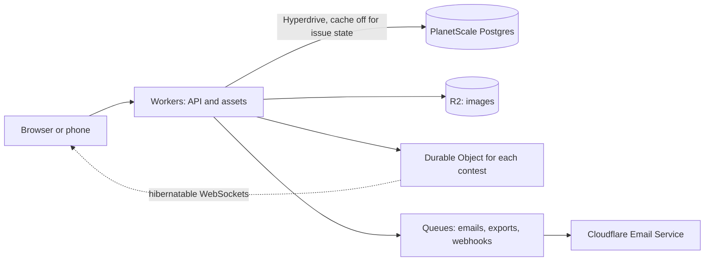

# Roadmap

This page states Minsky's goals and the stack that it may move to.
[Product direction](docs/product-direction.md) owns the product requirements.
[Cloudflare backend design](docs/cloudflare-backend-design.md) explains the system as built.

## Goals

The hosting model follows Codeforces and Let's Encrypt.

- **Free for every contest.** Organizers run a contest on Minsky at no cost, whether or not they have infrastructure of their own. Sponsors fund the hosting and maintenance, not organizers.
- **Self-hostable.** Anyone can run the same code on their own infrastructure.
- **Reliable hosting.** Contests anywhere in the world can reach support.

## Current stack

| Layer | Service |
| --- | --- |
| Language | TypeScript |
| Frontend | React and Vite |
| Authentication | Better Auth |
| Compute | Cloudflare Workers |
| Database | Cloudflare D1 (SQLite) |
| Blob storage | Cloudflare R2, for issue and announcement images |
| Live updates | Durable Objects, one for each contest |
| CI and publication | Cloudflare Workers Builds |
| Tests | Vitest and Playwright |

Each D1 database has one primary, runs one query at a time, and is limited to 10 GB.
[Scaling design](docs/scaling-design.md) states where this limit applies to Minsky.

## Target stack

The target stack is a proposal. None of the parts that differ from the current stack are built.

| Layer | Service | Reason |
| --- | --- | --- |
| Compute | Cloudflare Workers | Global and autoscaling, at low cost |
| Database | PlanetScale Postgres through Hyperdrive | Portable, and handles concurrent writes |
| Query layer | Drizzle ORM | One schema for Postgres and SQLite |
| Live updates | Durable Objects, one for each contest | WebSocket fan-out, and idle sockets cost nothing |
| Blob storage | R2 | No egress fees |
| Background jobs | Cloudflare Queues | Email, CSV export, and webhooks |
| Email | Cloudflare Email Service | Notifications and magic links |
| Authentication | Better Auth | Works with any provider, and the data stays in Postgres |
| Observability | Workers Logs and Sentry | Logs and error tracking |
| Backups | Nightly `pg_dump` to R2 | An off-site restore path |
| CI and publication | Cloudflare Workers Builds | Checks on every branch push, and docs publication |

## Other providers

Cloudflare is the only implementation. The contracts in `src/backend/contracts.ts` stay so that a later provider can implement them.
This table shows how each part could map to another host. None of these adapters exist.

| Part | Cloudflare | AWS | GCP | Azure | Self-hosted with Docker |
| --- | --- | --- | --- | --- | --- |
| Compute | Workers | Lambda or ECS Fargate | Cloud Run | Container Apps | Node server |
| Database | PlanetScale or D1 | RDS Postgres | Cloud SQL Postgres | Azure Database for PostgreSQL | Postgres |
| Live updates | Durable Objects | API Gateway WebSockets | Cloud Run WebSockets and Pub/Sub | Web PubSub | `ws` and Postgres `LISTEN/NOTIFY` |
| Blob storage | R2 | S3 | Cloud Storage | Blob Storage | Any S3-compatible store |
| Queue | Queues | SQS | Pub/Sub | Service Bus | Postgres-backed job queue |
| Email | Email Service | SES | Third-party SMTP | Azure Communication Services | SMTP |
