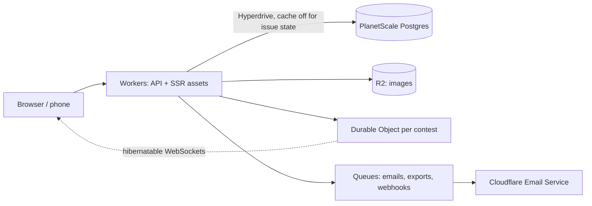

# Roadmap 
This file provides an overview of the general direction that Minsky will be heading. 

## Guiding Goals
In general, we wish for the platform's model to operate in a similar fashion to Codeforces and Let's Encrypt. 
- Free for every contest. This means that organizers are free to deploy this application to any contest they host for free, regardless of whether they have the infrastructure to support it or not. As such, the maintenance and hosting requirements should be funded by sponsors instead of organizers.
- Self-hostable anywhere. We wish to adhere to a similar model like Codeforces and Let's Encrypt.
- Highly reliable hosting. Everyone around the world should have access to efficient contest support. 

## Current stack 
| Layer | Service |
| --- | --- |
| Language | TypeScript |
| Frontend | React + Vite |
| Auth | better-auth |
| Compute | Cloudflare Workers (`minsky-dev`, `minsky-docs`) |
| Database | Cloudflare D1 (SQLite) |
| Blob storage | Cloudflare R2 (issue images) |
| Alt provider | Supabase adapter |
| CI/CD | Cloudflare Workers Builds |
| Tests | Vitest (unit), Playwright (end-to-end) |

**Limitation**: each D1 database has a single primary, runs one query at a time, and is capped at 10 GB.

## Target Stack

| Layer | Service | Reason |
| --- | --- | --- |
| Compute | Cloudflare Workers | Global, autoscaling, cheap |
| Database | PlanetScale Postgres via Hyperdrive | Portable, handles concurrent writes |
| Query layer | Drizzle ORM (proposed) | One schema for Postgres and SQLite |
| Realtime | Durable Objects, one per contest | WebSocket fan-out, idle sockets cost nothing |
| Blob storage | R2 | No egress fees |
| Background jobs | Cloudflare Queues | Email, CSV export, webhooks |
| Email | Cloudflare Email Service | Notifications, magic links |
| Auth | better-auth | Provider-agnostic, data stays in Postgres |
| Observability | Workers Logs + Sentry | Logs plus error tracking |
| Backups | Nightly `pg_dump` → R2 | Off-site restore path |
| CI/CD | GitHub Actions + Workers Builds | Test matrix plus deploys |
---

## Adapter matrix
| Port | Cloudflare | AWS | GCP | Azure | Self-host (Docker) |
| --- | --- | --- | --- | --- | --- |
| Compute | Workers | Lambda or ECS Fargate | Cloud Run | Container Apps | Node server |
| Database | PlanetScale / D1 | RDS Postgres | Cloud SQL Postgres | Azure Database for PostgreSQL | Postgres |
| Realtime | Durable Objects | API Gateway WebSockets | Cloud Run WebSockets + Pub/Sub | Web PubSub | `ws` + Postgres `LISTEN/NOTIFY` |
| Blob | R2 | S3 | Cloud Storage | Blob Storage | Any S3-compatible store |
| Queue | Queues | SQS | Pub/Sub | Service Bus | Postgres-backed job queue |
| Email | Email Service | SES | Third-party SMTP | Azure Communication Services | SMTP |

