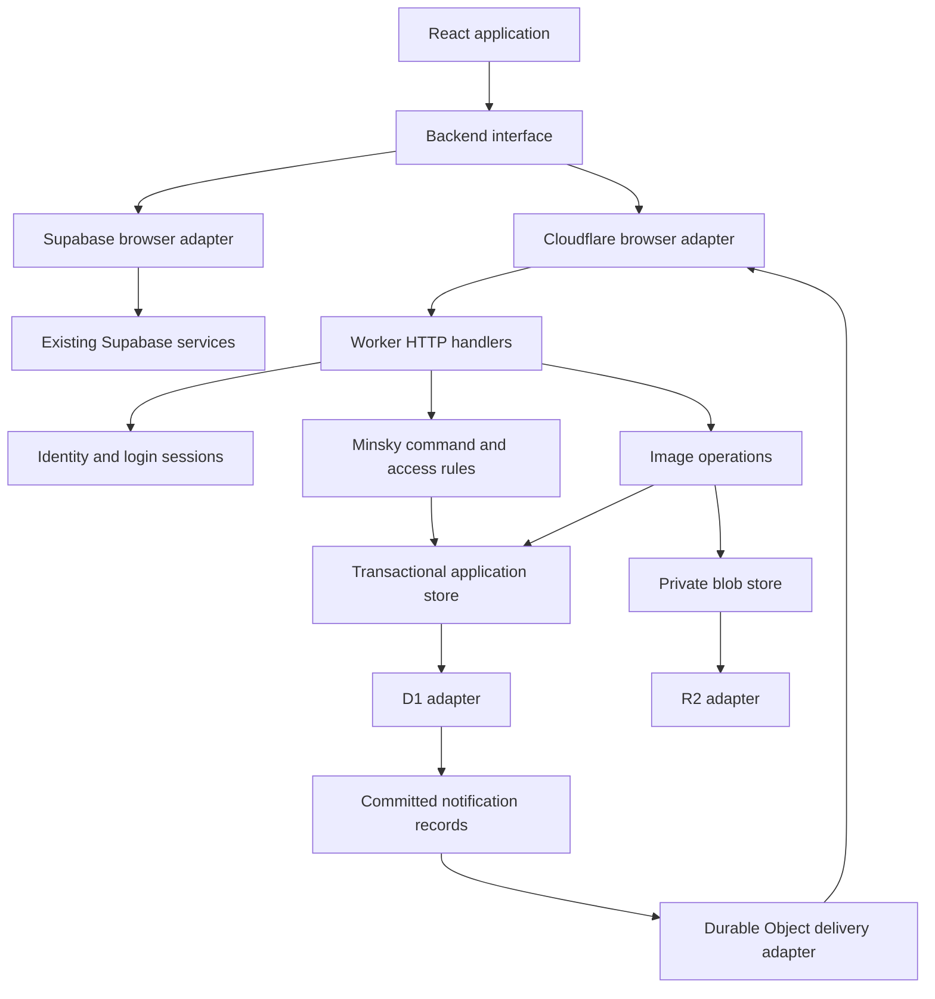

# Cloudflare backend design

This page explains the proposed Cloudflare backend and its provider boundaries.
T0016 began while PR #32 was under review. The user merged PR #32 on 2026-10-17.
T0017 starts the [D1 transaction proof](d1-transaction-proof.md).
The complete Cloudflare connector and migration tools remain later work.
The owner authorizes isolated development and CI resources for this implementation.
That authorization does not establish a hosted verification result.
Supabase remains the active backend.

The user selected Workers, D1 with a SQLite rewrite, private R2, and Durable Objects.
The migration preserves accounts, IDs, permissions, issue history, timestamps, awards, and image contents.
Possible AWS testing motivates portable interfaces. It does not add an AWS implementation to this change.

The [implementation plan](cloudflare-implementation-plan.md) defines the acceptance steps and unresolved decisions.
The [backend contracts](backend-contracts.md) describe the implemented browser interface.

## Two different adapter boundaries

`Backend` describes what the browser needs from Minsky.
The existing Supabase adapter translates those operations into Supabase calls.
A future Cloudflare adapter translates the same operations into authenticated HTTP requests and live subscriptions.

The server needs a separate boundary.
Moving browser calls behind `Backend` does not make PostgreSQL functions portable.
The Cloudflare server must implement their permission checks and atomic writes in SQLite.
A later AWS server can reuse domain rules without importing Cloudflare bindings.

The diagram shows the complete target. T0017 implements only the D1 transaction proof.
The Supabase path remains the active application backend.

## Modules have explicit responsibilities

The table proposes module responsibilities. It does not describe files already in the repository.

| Boundary | Responsibility | Provider details excluded from callers |
| --- | --- | --- |
| Browser `Backend` | Minsky operations and validated results. | SQL, SDK clients, bearer tokens, and subscription channels. |
| HTTP handlers | Validate requests, authenticate callers, and map typed results to responses. | Business rules inside route handlers. |
| Domain rules | Decide valid transitions and required changes from explicit account and workflow state. | Worker bindings, environment variables, SQL syntax, and network calls. |
| Application store | Read authorized state and commit an entire command with its preconditions, receipt, history, and notification records. | Generic table CRUD and caller-controlled transactions. |
| Identity service | Verify credentials and login sessions, change passwords, and revoke access. | Provider token formats and password storage details. |
| Blob store | Store immutable image objects, inspect content, read bytes, and retry deletion. | Bucket clients and provider URLs. |
| Change delivery | Deliver authorized snapshot invalidations and recover pending notifications. | Durable Object classes and WebSocket lifecycle details. |

A port is a typed interface at one of these server boundaries.
Ports describe complete Minsky operations, such as committing a workflow command.
They do not expose a generic `save(table, record)` API.
The application store owns the transaction needed by each operation.

Domain decisions use supplied state, time, and generated IDs.
The provider store verifies that the state remains current when it commits the decision.
Typed commit results distinguish a conflict, a confirmed rejection, and an unknown outcome.
Database constraints still protect relationships and uniqueness.

One deployment entry point constructs the provider implementations from explicit configuration.
Each authenticated request gets its own caller context.
There is no mutable global current provider or current user.
Provider imports stay in adapter modules. Domain code has no `if (provider === ...)` branches.
Simple constructors and function arguments are sufficient. A general dependency framework is unnecessary.

The Cloudflare HTTP response distinguishes a validated command result from an explicit, typed rejection.
The browser maps only a confirmed rejection to `WorkflowRejectedError`.
Timeouts, unexpected statuses, and malformed responses preserve the unknown outcome and request ID.
The response contains no raw SQL, provider error objects, or identity credentials.
An HTTP status alone does not prove that a command failed before commit.

AWS compatibility means implementing these semantics with another provider and passing the same tests.
It does not mean every provider has the same transaction or storage API.
Terraform can later provision selected resources. Terraform does not replace application adapters or behavior tests.

## D1 stores the authoritative application state

The first implementation uses one application database per environment.
The same database contains account access state and all memberships.
This permits password-reset authorization across every session assigned to an account.
Splitting databases by contest session would require a separate consistency design for that rule.

The SQLite schema retains UUIDs as stable identifiers and retains current issue numbers.
Migration initializes the issue-number allocator above the highest imported number.
Foreign keys retain session boundaries between teams, issues, resolutions, awards, and images.
Unique constraints retain one award per issue and one current resolution per issue.
Roles use explicit related records or validated JSON with equivalent membership checks.
The schema decision must not silently narrow the existing combination of staff roles.

Imported timestamps retain their precision and order.
The migration must test its timestamp encoding against PostgreSQL values before choosing the SQLite representation.
JavaScript millisecond timestamps alone are insufficient evidence of a lossless conversion.
Saved resolution intervals remain the basis of elapsed-time calculations.

The API is the only application route to D1.
Every read includes the authenticated account and its current access conditions.
The store assembles snapshots in one consistent database operation.
It excludes other teams' records and staff-only records before they leave the server.
Account status, login revocation, and mandatory password changes also guard file reads and live connections.

The initial design uses primary database reads for authorization and snapshots.
Cloudflare routes binding queries to the primary unless the application uses the Sessions API for replication.
Replica reads require a tested consistency rule for revocation and reads after writes before adoption.
See [D1 read replication](https://developers.cloudflare.com/d1/best-practices/read-replication/).

## One workflow command has one database commit

The existing [workflow function](../supabase/migrations/202610020003_private_signals.sql) commits state, history, signals, and the request receipt together.
The SQLite implementation must preserve that property.
D1 `batch()` accepts prepared statements and rolls back the batch if a statement fails.
It does not provide a JavaScript transaction callback around arbitrary asynchronous work.
See [the D1 database API](https://developers.cloudflare.com/d1/worker-api/d1-database/).

The proposed store first reads the state needed to evaluate a command.
Domain rules produce either a rejection or a complete change with expected versions.
The store submits one bounded batch with these elements:

1. An assertion checks the current login, account access version, membership versions, event state, session settings, and affected workflow versions.
2. A receipt reserves the unique pair of authenticated actor and request ID.
3. The batch writes the issue changes, history, resolution, or award.
4. The batch writes audience-specific notification records and the receipt result.

The assertions execute inside the batch.
A failed assertion must raise a database error and roll back every write.
A conditional update that affects zero rows must not allow the remaining writes to commit.
The first D1 implementation task must prove this assertion pattern with real D1 tests before it becomes the command foundation.

Every changed dependency increments its internal version in the same commit.
Membership changes also increment the affected account's access version.
Account-wide administration checks include the target account's complete membership set.
This prevents a concurrent membership grant from escaping a password-reset permission check.

The public issue revision remains the value used by `Command` in [model.ts](../src/connected/model.ts).
A separate internal write version detects concurrent changes that must not become public.
Private notes cannot increment the contestant-visible revision or send contestant notifications.
An internal conflict causes a bounded reread and reevaluation inside the server.
It must not reveal a private note through a public conflict message.

A stored receipt includes the session ID, canonical command, and result ID.
Canonical means that equivalent JSON object key order produces the same comparison.
Reusing the request ID with different content is a confirmed rejection.
A concurrent duplicate either commits once or reads the existing receipt after current access checks.
Transport loss and an unreadable success response leave the outcome unknown.
The adapter retains the original request ID, as the current UI requires.

There is no transaction across D1, R2, and Durable Objects.
The D1 commit records later work before any external side effect begins.
A retry repeats that work safely without repeating the workflow command.
Administration methods currently lack workflow-style request IDs.
Their implementation must define retry semantics before adding automatic retries or claiming the same guarantee.

## Authentication uses replacement temporary passwords

Account preservation and password preservation are different requirements.
The owner selected organizer-issued replacement temporary passwords on 2026-10-17.
Users must change these passwords before contest access.
Preserve account IDs, memberships, permissions, and history.
Existing passwords do not need to survive. Password-hash import is no longer required.

The replacement identity implementation remains unselected.
The proposed final boundary is a maintained identity implementation behind a small server port.
Minsky retains its username rules, organizer recovery, mandatory password changes, and cross-session authorization.

Authentication implementation follows the D1 proof.
Use fictional accounts to verify password creation, mandatory changes, private credential distribution, recovery, and Worker execution limits.
Full migration tooling follows connector verification.
The owner decision authorizes no real-account reset, credential export, or backend switch in T0017.
Supabase remains active during the proof and connector work.

The replacement must verify current login state for each protected operation.
A signed token alone does not prove that the login remains active.
Supabase itself documents that issued tokens can outlive session deletion.
See [Supabase session invalidation](https://supabase.com/docs/guides/auth/managing-user-data).

The proposed Worker API uses a secure, HttpOnly session cookie and an opaque login identifier for same-origin application requests.
The identity adapter owns expiry, rotation, and revocation. The browser receives no database credentials.
State-changing routes check the request origin and a cross-site request forgery token.
The WebSocket upgrade checks the origin and current login too.
Preview origins and cross-origin local development need an explicit allowlist and browser tests.
Cookie scope and session lifetime remain part of identity design review.

Password resets first place the account behind the mandatory-change gate and revoke earlier logins.
The authorization check, gate, account access version, and audit record commit together.
Only an administrator of every assigned session can reset the account or assign its initial username.
An archived event in any assigned session prevents these account changes.
The current behavior rejects replacement of an assigned username and directs self-resets to `changePassword()`.
See [the account administration rules](../supabase/migrations/202610020004_usernames.sql).
An external identity update uses a persisted operation record with a retryable completion state.
Failure leaves the account restricted instead of restoring an earlier valid login.
The [current credential migration](../supabase/migrations/202610140001_attachment_fixes.sql) provides the behavior to preserve.

## Private R2 images use explicit lifecycle states

The browser keeps the existing `ImageTransport` operations and logical image paths.
The Worker authenticates every upload, completion, download, removal, and abandonment.
The R2 bucket has no public route.
The first implementation proxies downloads through the Worker with private, non-cacheable responses.
This avoids a reusable public link after membership revocation.

`begin()` atomically reserves an attachment, its immutable visibility, declared bytes, quota allowance, and request receipt in D1.
Only staff can reserve an image in an active event.
Reservations count toward limits so concurrent uploads cannot exceed the limit.

An upload writes immutable object bytes under the reserved original or thumbnail key.
Conditional object creation prevents two attempts from replacing each other's validated bytes.
An existing object requires content verification before a retry counts as success.
R2 supports conditional writes through its Worker binding.
See [R2 conditional operations](https://developers.cloudflare.com/r2/api/workers/workers-api-reference/).

`finish()` verifies both objects, actual sizes, and supported image headers.
The checks retain [imageFile.ts](../src/connected/imageFile.ts) behavior for JPEG, PNG, WebP, and thumbnails.
The final D1 commit rechecks the login, uploader, membership, event state, quota, and reservation.
Only that commit changes the attachment to ready and records visible activity.
Repeating `finish()` after success returns success without another activity record.

Removal first commits a tombstone, which marks the image unavailable, with the authorized uploader and a durable deletion task.
Only the uploader can remove a ready image while its event is active.
R2 deletion and completion of the task happen afterward.
File access rejects a tombstone immediately, even if object deletion needs another attempt.

Expired or abandoned uploads also create deletion tasks for their exact keys.
An upload that finishes after revocation or expiry cannot publish its object.
The worker rechecks reservation state after upload. A recovery scan removes orphaned bytes after interrupted requests.
The cleanup design retains tombstones long enough to handle late uploads instead of deleting the evidence after the first successful delete.
Its tests must cover upload, expiry, deletion, and process interruption in every order.

R2 object consistency does not make a D1 metadata change and an R2 write atomic.
Cache behavior can also differ from direct bucket reads.
See [R2 consistency](https://developers.cloudflare.com/r2/reference/consistency/).

## Durable Objects deliver invalidations

D1 stores a pending notification with each committed change.
This table is an outbox, a durable record of notifications still needing delivery.
It contains the session, permitted audience, sequence, and delivery status.
It contains no issue text, image key, password, or private note body.

The proposed connection coordinator is one Durable Object per contest session.
The Worker attempts delivery after the database commit.
A scheduled recovery scan retries pending rows if the Worker stops before delivery.
The coordinator accepts repeated deliveries and ignores older duplicate sequences for the same audience.
Acknowledging delivery means that the coordinator accepted the invalidation. It does not prove that every browser received it.

Team changes reach the affected team and staff.
Staff-only changes reach staff only.
Private changes use separate sequences, so contestant notifications and counters cannot reveal their existence.
Membership changes and password resets produce targeted access invalidations.
The coordinator rechecks current authorization before each delivery and closes invalid logins.
An unavailable authorization service causes delivery to stop rather than reuse stale permissions.

The coordinator stores each socket's account ID, login ID, session ID, and expiry.
Those values identify a connection. They do not replace current permission checks.
Hibernation can retain sockets while clearing ordinary memory, so connection metadata must survive through socket attachments.
See [Durable Objects WebSocket hibernation](https://developers.cloudflare.com/durable-objects/best-practices/websockets/).

An expiry alarm closes expired connections. Access invalidations request earlier closure.
Alarm handlers must tolerate repeat execution and explicitly reschedule unresolved work.
Cloudflare retries failed alarms a bounded number of times.
See [Durable Objects alarms](https://developers.cloudflare.com/durable-objects/api/alarms/).

Every successful connection or reconnect triggers a fresh authorized snapshot.
A missed invalidation cannot require the browser to reconstruct issue history from messages.
The existing focus refresh and ten-second polling remain until tests justify a replacement.
Closing a subscription stops callbacks immediately and releases the socket and timers.

The healthy-connection target remains live updates within three seconds.
Immediate delivery is the normal path. Recovery scans and polling handle missed messages but do not establish that latency target.
Hosted latency, fan-out, revocation, and recovery tests must measure the implementation.

## Separate deployment and data migration

The documentation Worker remains a static site with no application data bindings.
The application Worker serves static assets and routes backend requests under the same origin in the proposed Cloudflare deployment.
Development, CI, and future production use separate databases, buckets, object namespaces, and identity credentials.
Untrusted branch previews receive no shared database write access or privileged credentials.

The first proof uses fictional fixtures in local emulation and isolated hosted D1 resources.
The owner authorizes separate development and CI resources in the existing Cloudflare account.
Check existing Wrangler access before requesting credentials. Keep tokens out of chat and logs.

The existing OAuth login was checked against account `458ad6a930b0fb717796dfa19ca6a2b1`, which matches the repository configuration.
Verify that account before provisioning. Document the concrete need and cost before any paid upgrade.
Subagents may perform independent, bounded tasks.

Record hosted evidence in [the proof guide](d1-transaction-proof.md) before claiming transaction verification.
Passing that suite does not prove a fresh installation, a data migration, or capacity for 800 simultaneous users.
Each claim needs its own evidence.

Authentication and the remaining connector operations follow the D1 proof.
Full migration tooling follows connector verification. Real-data exports and the backend switch remain later phases.
AWS adapters and Terraform remain deferred.

Cutover uses one writable backend at a time.
The migration rehearsal compares IDs, references, timestamps, receipts, image hashes, and authorized snapshots.
It also checks login, mandatory password changes, recovery, and historical actor names.
The proposal has no background dual writes.

Before Cloudflare accepts new writes, rollback can restore the unchanged Supabase application after verification.
After Cloudflare accepts writes, switching URLs alone loses changes.
A post-write rollback must either import and verify those changes or keep writes paused while operators repair Cloudflare.
The rehearsal must settle and test that procedure before cutover approval.

Authentication selection, transaction proof, provider tests, and rollback rehearsal remain acceptance requirements.
The design does not authorize a provider upgrade or claim that free-tier limits meet the contest target.
Resource and query estimates must use the measured implementation and current [D1 limits](https://developers.cloudflare.com/d1/platform/limits/) before deployment.
