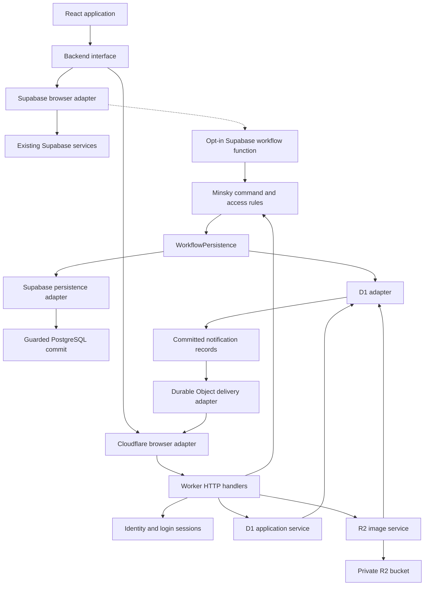

# Cloudflare backend design

This page explains the Cloudflare connector and its provider boundaries.
The browser uses the same `Backend` contract for Supabase and Cloudflare.
Issue decisions use one `WorkflowService`. Provider adapters supply persistence, authentication, images, and live delivery.
Supabase remains the active development backend.

The user selected Workers, D1 with a SQLite rewrite, private R2, and Durable Objects.
A later migration must preserve accounts, IDs, permissions, issue history, timestamps, awards, and image contents.
See [migration gates](product-direction.md#migration-and-cutover-gates) for the deferred cutover requirements.
See [backend contracts](backend-contracts.md) for the browser interface and [current state](current-state.md) for dated evidence.

## Two different adapter boundaries

`Backend` describes what the browser needs from Minsky.
The existing Supabase adapter translates those operations into Supabase calls.
The Cloudflare adapter translates the same operations into authenticated HTTP requests and live subscriptions.

The server needs a separate boundary.
Moving browser calls behind `Backend` does not make PostgreSQL functions portable.
The [shared workflow service](server-workflow.md) applies the existing issue decisions.
The Cloudflare server reuses those decisions and enforces their commit conditions through its SQLite adapter.
A later AWS server can reuse the same service without importing Cloudflare bindings.

The diagram includes the Cloudflare connector and the separate Supabase verification path.
The opt-in Supabase function executes every issue command through the shared service.
The D1 adapter persists all nine commands from that service.
The complete [application Worker](../src/server/adapters/cloudflare/applicationWorker.ts) combines authenticated workflow, reads, administration, images, and live connections.
It guards current identity sessions and credential generations inside workflow commits.
The active Supabase browser workflow still calls the legacy RPC.
The dotted connection identifies the opt-in executor used for replacement verification.

## Modules have explicit responsibilities

The table defines the boundaries.
The [workflow reference](server-workflow.md) identifies implemented workflow modules and remaining provider-specific paths.
The Cloudflare implementations remain inside provider adapter modules.

| Boundary | Responsibility | Provider details excluded from callers |
| --- | --- | --- |
| Browser `Backend` | Minsky operations and validated results. | SQL, SDK clients, bearer tokens, and subscription channels. |
| HTTP handlers | Validate requests, authenticate callers, and map typed results to responses. | Business rules inside route handlers. |
| Domain rules | Decide valid transitions and required changes from explicit account and workflow state. | Worker bindings, environment variables, SQL syntax, and network calls. |
| `WorkflowPersistence` | Read authorized workflow state and commit a decision with its preconditions, receipt, history, and notifications. | Generic table CRUD and caller-controlled transactions. |
| Identity service | Verify credentials and login sessions, change passwords, and revoke access. | Provider token formats and password storage details. |
| Blob store | Store immutable image objects, inspect content, read bytes, and retry deletion. | Bucket clients and provider URLs. |
| Change delivery | Deliver authorized snapshot invalidations and recover pending notifications. | Durable Object classes and WebSocket lifecycle details. |

The application Worker constructs [D1 application access](../src/server/adapters/cloudflare/application.ts), [R2 images](../src/server/adapters/cloudflare/images.ts), and [live delivery](../src/server/adapters/cloudflare/live.ts).
The [browser adapter](../src/backend/cloudflare/backend.ts) implements every `Backend` group.
Issue decisions remain shared. Other operations preserve their behavior in the corresponding provider server adapter.
The [operator tooling](../src/server/adapters/cloudflare/tooling/install.mjs) owns Cloudflare configuration, target checks, bootstrap, and owner recovery.

`WorkflowPersistence` defines complete workflow operations.
Each persistence adapter owns the transaction needed by an operation.

Workflow decisions use explicit authorized state.
The persistence adapter supplies authoritative timestamps and generated IDs during commit.
The provider store verifies that the state remains current when it commits the decision.
Typed commit results distinguish a conflict, a confirmed rejection, and an unknown outcome.
Database constraints still protect relationships and uniqueness.

One deployment entry point constructs the provider implementations from explicit configuration.
Each authenticated request gets its own caller context.
There is no mutable global current provider or current user.
Provider imports stay in adapter modules. Domain code has no `if (provider === ...)` branches.
Simple constructors and function arguments are sufficient. A general dependency framework is unnecessary.

The Cloudflare HTTP response distinguishes a validated command result from an explicit, typed rejection.
The browser maps only a confirmed rejection to `WorkflowRejectedError`.
Timeouts, unexpected statuses, and malformed responses preserve the unknown outcome and request ID.
The response contains no raw SQL, provider error objects, or identity credentials.
An HTTP status alone does not prove that a command failed before commit.

AWS compatibility means implementing these semantics with another provider and passing the same tests.
It does not mean every provider has the same transaction or storage API.
Terraform can later provision selected resources. Terraform does not replace application adapters or behavior tests.

## D1 stores the authoritative application state

The connector uses one application database per environment.
The complete schema includes workflow, account, administration, image, and notification records.
The same database contains account access state and all memberships.
This permits password-reset authorization across every session assigned to an account.
Splitting databases by contest session would require a separate consistency design for that rule.

The SQLite schema retains UUIDs as stable identifiers and retains current issue numbers.
Submission allocates a number above the current session's existing issue numbers inside its commit.
Foreign keys retain session boundaries between teams, issues, resolutions, awards, and images.
Unique constraints retain one award per issue and one current resolution per issue.
Roles use explicit membership-role records and retain combined staff capabilities.

New D1 commits obtain ISO 8601 timestamps from the database.
Data import remains deferred.
A later migration must preserve imported timestamp precision and order and verify its encoding against PostgreSQL values.
The current timestamp format alone does not prove a lossless import.
Saved resolution intervals remain the basis of elapsed-time calculations.

The browser accesses D1 through the authenticated Worker API.
Trusted operator commands and isolated fixtures use provider bindings separately.
Every read includes the authenticated account and its current access conditions.
The store assembles snapshots in one consistent database operation.
It excludes other teams' records and staff-only records before they leave the server.
Account status, login revocation, and mandatory password changes also guard file reads and live connections.

The implementation uses primary database reads for authorization and snapshots.
Cloudflare routes binding queries to the primary unless the application uses the Sessions API for replication.
Replica reads require a tested consistency rule for revocation and reads after writes before adoption.
See [D1 read replication](https://developers.cloudflare.com/d1/best-practices/read-replication/).

## One workflow command has one database commit

The existing [workflow function](../supabase/migrations/202610020003_private_signals.sql) commits state, history, signals, and the request receipt together.
The SQLite implementation preserves that property.
D1 `batch()` accepts prepared statements and rolls back the batch if a statement fails.
It does not provide a JavaScript transaction callback around arbitrary asynchronous work.
See [the D1 database API](https://developers.cloudflare.com/d1/worker-api/d1-database/).

The store first reads the state needed to evaluate a command.
Domain rules produce either a rejection or a complete change with expected versions.
The store submits one bounded batch with these elements:

1. An assertion checks current access and the captured account, membership, event, session, and workflow dependencies.
2. The batch obtains one database timestamp and writes the issue, resolution, reopening, or award effects.
3. The batch records history, the unique actor/request receipt, and audience-specific notifications.
4. A final access assertion rejects expiry or revocation before the batch completes.

The assertions execute inside the batch.
A failed assertion must raise a database error and roll back every write.
A conditional update that affects zero rows must not allow the remaining writes to commit.

Every changed dependency increments its internal version in the same commit.
Membership changes also increment the affected account's access version.
Account-wide administration checks include the target account's complete membership set.
This prevents a concurrent membership grant from escaping a password-reset permission check.

The public issue revision remains the value used by `Command` in [model.ts](../src/connected/model.ts).
A separate internal write version detects concurrent changes that must not become public.
Private notes cannot increment the contestant-visible revision or send contestant notifications.
An internal conflict causes a bounded reread and reevaluation inside the server.
It must not reveal a private note through a public conflict message.

A stored receipt includes the session ID, canonical command, and result ID.
Canonical means that equivalent JSON object key order produces the same comparison.
Reusing the request ID with different content is a confirmed rejection.
A concurrent duplicate either commits once or reads the existing receipt after current access checks.
Transport loss and an unreadable success response leave the outcome unknown.
The adapter retains the original request ID, as the current UI requires.

There is no transaction across D1, R2, and Durable Objects.
The D1 commit records later work before any external side effect begins.
A retry repeats that work safely without repeating the workflow command.
Administration methods currently lack workflow-style request IDs.
The browser does not automatically retry those administration calls with a workflow-style guarantee.
An uncertain credential result requires checking account state or issuing a later authorized reset.

## Authentication uses replacement temporary passwords

Account preservation and password preservation are different requirements.
The owner selected organizer-issued replacement temporary passwords on 2026-10-17.
Users must change these passwords before contest access.
Preserve account IDs, memberships, permissions, and history.
Existing passwords do not need to survive. Password-hash import is no longer required.

The Cloudflare identity adapter uses maintained Better Auth.
See [the implementation reference](cloudflare-authentication.md) and [choice with costs](cloudflare-authentication-choice.md).
The isolated Cloudflare application uses this identity boundary.
The active Supabase development application retains Supabase authentication.
Minsky retains its username rules, organizer recovery, mandatory password changes, and cross-session authorization.

The connector verifies current login state for each protected operation.
A signed token alone does not prove that the login remains active.
Supabase itself documents that issued tokens can outlive session deletion.
See [Supabase session invalidation](https://supabase.com/docs/guides/auth/managing-user-data).

The Worker API uses a secure, HttpOnly session cookie and an opaque login identifier for same-origin application requests.
The identity adapter owns expiry, rotation, and revocation. The browser receives no database credentials.
State-changing routes check the request origin and a cross-site request forgery token.
The WebSocket upgrade checks the origin and current login too.
Preview origins and cross-origin local development need an explicit allowlist and browser tests.
The application uses host-only HttpOnly cookies, SameSite Strict, and a fixed eight-hour lifetime.
Hosted cookies require Secure. The authentication reference defines exact origins and request protection.

Password resets first place the account behind the mandatory-change gate and revoke earlier logins.
The authorization check, gate, account access version, and audit record commit together.
Only an administrator of every assigned session can reset the account or assign its initial username.
An archived event in any assigned session prevents these account changes.
The current behavior rejects replacement of an assigned username and directs self-resets to `changePassword()`.
See [the account administration rules](../supabase/migrations/202610020004_usernames.sql).
A credential update uses a persisted operation record with a guarded completion state.
Failure leaves the account restricted instead of restoring an earlier valid login.
The [current credential migration](../supabase/migrations/202610140001_attachment_fixes.sql) provides the behavior to preserve.

## Private R2 images use explicit lifecycle states

The browser keeps the existing `ImageTransport` operations and logical image paths.
The Worker authenticates every upload, completion, download, removal, and abandonment.
The R2 bucket has no public route.
The implementation proxies downloads through the Worker with private, non-cacheable responses.
This avoids a reusable public link after membership revocation.

`begin()` atomically reserves an attachment, its immutable visibility, declared bytes, quota allowance, and request receipt in D1.
Only staff can reserve an image in an active event.
Reservations count toward limits so concurrent uploads cannot exceed the limit.

An upload writes immutable object bytes under the reserved original or thumbnail key.
Conditional object creation prevents two attempts from replacing each other's validated bytes.
An existing object requires content verification before a retry counts as success.
R2 supports conditional writes through its Worker binding.
See [R2 conditional operations](https://developers.cloudflare.com/r2/api/workers/workers-api-reference/).

`finish()` verifies both objects, actual sizes, and supported image headers.
The checks retain [imageFile.ts](../src/connected/imageFile.ts) behavior for JPEG, PNG, WebP, and thumbnails.
The final D1 commit rechecks the login, uploader, membership, event state, quota, and reservation.
Only that commit changes the attachment to ready and records visible activity.
Repeating `finish()` after success returns success without another activity record.

Removal first commits a tombstone, which marks the image unavailable, with the authorized uploader and a durable deletion task.
Only the uploader can remove a ready image while its event is active.
R2 deletion and completion of the task happen afterward.
File access rejects a tombstone immediately, even if object deletion needs another attempt.

Expired or abandoned uploads also create deletion tasks for their exact keys.
An upload that finishes after revocation or expiry cannot publish its object.
The worker rechecks reservation state after upload. A recovery scan removes orphaned bytes after interrupted requests.
Recovery retains tombstones and repeats exact-key deletion to catch late transfers.

R2 object consistency does not make a D1 metadata change and an R2 write atomic.
Cache behavior can also differ from direct bucket reads.
See [R2 consistency](https://developers.cloudflare.com/r2/reference/consistency/).

## Durable Objects deliver invalidations

D1 stores a pending notification with each committed change.
This table is an outbox, a durable record of notifications still needing delivery.
It contains the session, permitted audience, sequence, and delivery status.
It contains no issue text, image key, password, or private note body.

The connection coordinator is one Durable Object per contest session.
The Worker attempts delivery after the database commit.
A scheduled recovery scan retries pending rows if the Worker stops before delivery.
The coordinator accepts repeated deliveries and ignores older duplicate sequences for the same audience.
Acknowledging delivery means that the coordinator accepted the invalidation. It does not prove that every browser received it.

Team changes reach the affected team and staff.
Staff-only changes reach staff only.
Private changes use separate sequences, so contestant notifications and counters cannot reveal their existence.
Membership changes and password resets produce targeted access invalidations.
The coordinator rechecks current authorization before each delivery, including duplicate hints, and closes invalid logins.
An unavailable authorization service causes delivery to stop rather than reuse stale permissions.

The coordinator stores each socket's account ID, login ID, session ID, and expiry.
Those values identify a connection. They do not replace current permission checks.
Connection metadata survives hibernation through socket attachments.
See [Durable Objects WebSocket hibernation](https://developers.cloudflare.com/durable-objects/best-practices/websockets/).

An alarm checks current access and closes expired or revoked connections.
Access invalidations request earlier checks.
The handler reschedules checks for its remaining sockets.
Cloudflare retries failed alarms a bounded number of times.
See [Durable Objects alarms](https://developers.cloudflare.com/durable-objects/api/alarms/).

Every successful connection or reconnect triggers a fresh authorized snapshot.
A missed invalidation cannot require the browser to reconstruct issue history from messages.
The existing focus refresh and ten-second polling remain until tests justify a replacement.
Closing a subscription stops callbacks immediately and releases the socket and timers.

The healthy-connection target remains live updates within three seconds.
Immediate delivery is the normal path. Recovery scans and polling handle missed messages but do not establish that latency target.

## Separate deployment and data migration

The documentation Worker remains a static site with no application data bindings.
The application Worker serves static assets and backend requests under one origin.
The generated configuration runs the Worker before static asset handling, so private-path checks also apply to application routes.
Development, CI, and future production use separate databases, buckets, object namespaces, and identity credentials.
Untrusted branch previews receive no shared database write access or privileged credentials.

The installation procedure requires an empty isolated database and explicit provider targets.
Use [Install an isolated Cloudflare instance](../site/src/content/docs/operators/installation.md) for configuration, bootstrap, and recovery.
The [PR #21 component record](pr21-installation-disposition.md) preserves reuse decisions and the owner's closure decision.

Data exports, migration tooling, and backend cutover remain deferred.
The [migration gates](product-direction.md#migration-and-cutover-gates) require one writable backend, comparison of preserved data, and a tested rollback procedure.
Each installation must establish its own capacity and latency evidence before live-contest use.
