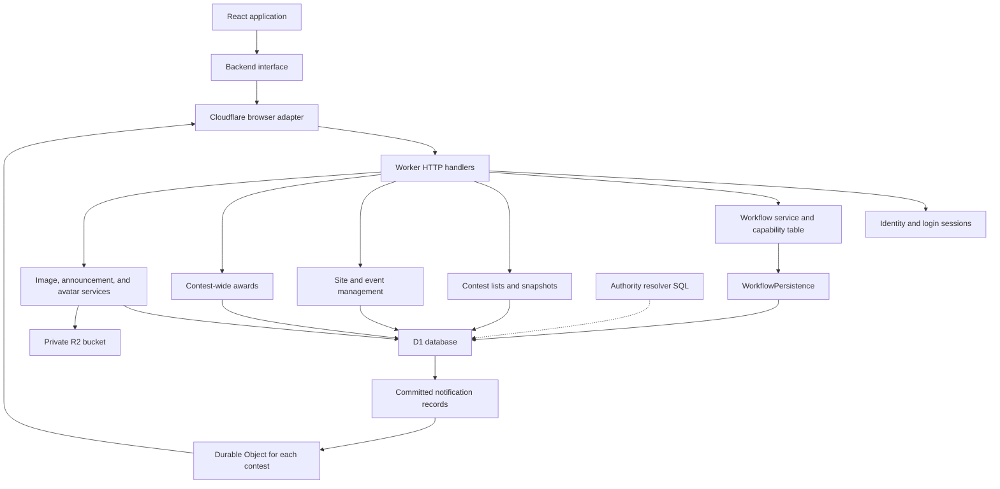

# Cloudflare backend design

This page explains how Minsky runs on Cloudflare and why it has this shape.
A browser talks to one Worker on one origin. The Worker keeps all authoritative state in one D1 database, stores image files in one private R2 bucket, and uses one Durable Object for each contest to send live hints.
Cloudflare is the only backend.

The system needs a network connection. No production installation exists. Live-contest use and the target of 800 simultaneous users are not verified.

[Backend contracts](backend-contracts.md) and the [server workflow reference](server-workflow.md) are the references. [Install on Cloudflare](../site/src/content/docs/operators/installation.mdx) is the procedure.

## Two different adapter boundaries

`Backend` describes what the browser needs from Minsky. The Cloudflare adapter translates those operations into same-origin HTTP requests and live subscriptions.

The server needs a separate boundary, because moving browser calls behind `Backend` does not make database code portable.
`WorkflowService` holds the issue decisions. They use explicit authorized state and no Worker bindings. `WorkflowPersistence` supplies the read and the guarded commit, and it owns timestamps and generated IDs.
A later provider can reuse the service without importing Cloudflare bindings. [Add a backend provider](add-provider.md) lists what that takes.

Only issue decisions are shared. Contest reads, management, images, announcements, and live delivery stay inside the Cloudflare adapter, because no second caller needs a shared interface.

One deployment entry point, [applicationWorker.ts](../src/server/adapters/cloudflare/applicationWorker.ts), constructs the services with plain constructors. Each authenticated request gets its own `Caller`. There is no mutable global current provider or current user.

The HTTP response separates a validated result from a typed rejection, and the browser maps only a confirmed rejection to a rejection error. A timeout, an unexpected status, or a malformed response preserves the unknown outcome and the request ID, because an HTTP status alone does not prove that a command failed before its commit.

## The site holds events, and events hold contests

One installation is one site. Three kinds of record organize it:

- A **webmaster** is a site account with a site grant. A site account belongs to no event, and it cannot sign in without that grant. Bootstrap creates exactly one webmaster and nothing else. The webmaster then creates events.
- An **event** has a name, a site-unique code, and an IANA time zone. Every other account belongs to one event and never moves. A person signs in with the event code and a handle, and the handle is unique inside that event.
- A **contest** belongs to one event. It has a kind, a type, a schedule, categories, and image limits. Its kind is `practice` or `live`, and it never changes. Its type is `singles`, `teams`, or `mixed`.

The event owns its roster. An **entrant** is a team or a single contestant, with one sign-in account that a team shares. A **seat** is what an account holds in one contest: a contestant seat, or a staff seat with an admin flag and roles.
Assigning an entrant to a contest creates its **entry**, with a location. D1 triggers then seat the entrant's sign-in and check the contest type. Renaming an entrant renames every entry.
An entrant's sign-in never holds a staff seat, a role, or a grant.

The database has its own names for these records. `sessions` holds contests, `teams` holds entries, and `memberships` and `membership_roles` hold seats.

One database holds every event. An account's access, its seats, and its credentials can then change in one atomic batch. Splitting the database by event or by contest would need a separate consistency design for that rule.

## One resolver decides what an account may do

[authority.ts](../src/server/adapters/cloudflare/authority.ts) answers one question for one target, which is the site, an event, or a contest. Every reader and writer of contest data embeds it: snapshots, workflow commands, images, announcements, avatars, live connections, the contest list, contest settings, and account changes.
It is SQL and not TypeScript, because a write batch must evaluate the same answer again at commit. D1 has no callback that could run TypeScript inside a transaction.

The contest form of the resolver merges three sources:

- A membership and its roles in the contest.
- An event grant for the contest's event. The holder is an event admin.
- A site grant. The holder is a webmaster.

The answer has three parts:

- `manage` ranks authority over structure: `none`, `contest`, `event`, or `site`.
- `seat` answers questions about contest data. [capabilities.ts](../src/connected/capabilities.ts) holds the one table of what a seat may do. Workflow decisions and the browser's page gates both read it.
- `stamp` holds every version that the answer depends on. A write batch evaluates the resolver again and compares the stamp, so a change to a grant, membership, role, login, contest, event, or site setting fails the batch.

Event admins and webmasters resolve to an admin seat in every contest that they reach, so the rules for contest admins apply to them unchanged. They still cannot award or claim without a role.

D1 enforces the isolation between events. Triggers refuse a membership or an event grant that crosses events, and an account never changes its event, so a Worker bug cannot create such a record.
A repository test, `authorityCopies.test.ts`, fails when server code outside the resolver contains its own access join.

**Webmaster reads.** While the site setting `restrict_webmaster_reads` is on, a webmaster reads a contest's data only after an audited join. D1 refuses a join while the setting is off, and it writes both audit rows of a join itself, so no writer can skip them. The contest's admins read one row, and the site record keeps the other. Structure authority ignores the setting, so a webmaster can still reset accounts and edit schedules without joining.

**Account management.** One SQL condition, `manageAccountSql`, decides who may change another account:

- A webmaster may manage any other account.
- An event admin may manage any other account of the event.
- A contest admin may manage an account that holds no grant, when the admin administers every contest that seats the account and the event is not archived.

A D1 trigger repeats the core of this rule on every password issue and rename, so a lower authority cannot reset or rename a higher one. Other triggers keep the last enabled webmaster. No other per-contest rule protects a last admin, because event admins and webmasters always reach every contest.

## Management commands share one path

[manage.ts](../src/server/adapters/cloudflare/manage.ts) serves site and event administration. `GET /api/site` and `GET /api/event` are single reads. Every change goes through `POST /api/manage` with one command union.

Each command follows the same steps: parse, receipt replay, requirement, authority, plan, and one D1 batch. The requirement comes from the command alone, from the table `requirementOf`, so a caller never names its own authority. The batch checks the authority stamp before its writes, and it checks the login after them. It stores the receipt, the audit row, and the notifications with those writes.
One path means one receipt table, one guard, and one audit rule for 22 commands. The cost is one large `plan()` switch, which is easier to audit than many separate handlers.

Passwords are the exception, because each hash costs Worker CPU time. `POST /api/credentials` takes at most eight accounts, hashes every password first, and then replaces them in one batch. An interrupted issue changes nothing, and the old password stays valid. A new account has a `pending` credential state, so it cannot sign in until an issue gives it a password.

## The schedule derives intake

A contest stores `starts_at`, `ends_at`, `grace_minutes` of at most 240, `intake_follows_schedule`, and `intake_open`. A contest runs continuously, and contests may overlap. The server stores UTC instants, and the browser shows them in the event's time zone.

Intake is never stored or flipped. [schedule.ts](../src/server/adapters/cloudflare/schedule.ts) holds SQL that evaluates D1's clock in every read and again inside the submit batch, in this order:

1. A live contest with a seat that waits for a password is closed. No override opens it.
2. While the contest follows its schedule, intake is open from the start until the end plus the grace period.
3. Otherwise `intake_open` decides, which is the manual override. A contest row without a schedule always takes this branch.

No cron job writes intake, so there is no moment when the stored state and the clock disagree, and no audit actor for a change that nobody made.
A submit that crosses the close fails its batch, because the workflow dependency value holds the intake state. Time sends no live hint. The browser reads again at `changes_at` with up to 15 seconds of random delay, so that a whole venue does not read in the same second. That read only updates the screen, and the server's check stays authoritative.

Intake restricts only contestant submissions. Staff work and reopening continue after it closes.

**Personal end time.** A contestant's end is the scheduled end plus every minute that staff confirmed as applied, from awards on the entry's issues and from contest-wide awards. The snapshot returns this value, and the browser only displays it.

**Contest-wide awards.** Jury grant minutes to every contestant of a contest. Support or jury then confirm that the minutes were applied outside Minsky, because Minsky changes no external clock. The decision and the confirmation are separate records. Only a confirmed award adds time. Jury can withdraw an unconfirmed award, and the record stays. A partial unique index allows one unconfirmed award of each size in a contest, so a reload after a lost response cannot record a second award with a new request ID.
An issue award has no such withdrawal. A wrong issue award stays, and the issue cannot take a corrected one.

**Calendar.** `contests({ window })` serves the calendar. A member lists every contest of the own event, and a webmaster lists every event. There is no public listing.

## Live contests wait for fresh passwords

A live contest gets fresh passwords. Its intake stays closed until every contestant seat holds a completed password issued for it. A practice contest has no such gate.

`credential_scopes` records the live contests that an account's current password was issued for. `sessions.unready_seats` counts the contestant seats without a scope. D1 triggers keep this count exact, so the intake check reads one column instead of counting up to 800 seats on every snapshot.

The server derives the set of contests that a new password opens. It holds the live contests of the account's entries whose window overlaps the window of the target contest. A window runs from the scheduled start to the scheduled end plus grace. The organizer names only the target contest and cannot widen or narrow the set.
So one issue serves overlapping live contests that share a sign-in, and an issue on day 1 never opens a contest on day 3.

Four rules follow from this:

- An issue is refused when it would sign a contestant out of a contest with open intake outside the set.
- An issue that would stop the password of a live contest that has not ended needs `voidLivePasswords`. The event console shows those contests first.
- Each scope stores the target's window at the time of the issue. A schedule move that leaves this fixed window ends the scope and recounts the seats, so small repeated moves cannot walk away from an old password. A move that would stop a running contest is refused.
- `assign_entrants` and `add_entrant_sign_in` add seats that wait for a password. When that would close an open live contest, the command needs `closeReporting`. The event console asks first.

An account's own password change keeps its scopes, because the password still follows that issue. An organizer's reset ends them.

## D1 stores the authoritative application state

UUIDs identify records inside one installation. Submission allocates an issue number inside its commit. Foreign keys keep records inside their contest. Unique constraints keep one award per issue and one current resolution per issue.
Each commit takes ISO 8601 timestamps from the database. Saved resolution intervals are the basis of elapsed-time calculations.

The browser reaches D1 only through the Worker API. Every read includes the authenticated account and its current access conditions. A snapshot is one database statement, so it is consistent, and it leaves out other teams' records and staff-only records before they leave the server.

Minsky reads only from the D1 primary. Cloudflare routes binding queries to the primary unless an application uses the [Sessions API for read replication](https://developers.cloudflare.com/d1/best-practices/read-replication/). Replica reads would need a tested consistency rule for revocation and for reads after writes.

D1 compiles every statement on every call, so the shape of a statement matters as much as its rows. Three tests guard the reads. `queryPlans.test.ts` fails if a snapshot query scans a table or loses its indexes. `readVolume.test.ts` fails if the rows read grow. `cronReads.test.ts` fails if a cron statement scans a table or reads more rows than the work needs, and it allows one scan, of the password-attempt counters. The [read-volume baseline](measurements/read-volume-baseline-2026-10-26.md), the [scaling design](scaling-design.md), and the [scoped authority record](measurements/scoped-authority-gate.md) hold the dated numbers.

## One workflow command has one database commit

A workflow command commits state, history, notifications, and the request receipt together.
D1 `batch()` accepts prepared statements and rolls back the batch if a statement fails. It has no [transaction callback](https://developers.cloudflare.com/d1/worker-api/d1-database/) around asynchronous work, so the code cannot read, decide in TypeScript, and write inside one transaction.

The store therefore reads first, and the domain rules produce a rejection or a complete change. The batch then proves that nothing changed. It inserts an assertion row with a `CHECK`, so a false condition raises a database error and rolls back every write. A conditional update that affects zero rows cannot let later writes commit, because an assertion follows it. The [server workflow reference](server-workflow.md#d1-workflow-persistence) lists the steps of the batch.

The public issue revision is the value that `Command` carries. A separate internal write version detects concurrent changes that must not become public, so a private note cannot increment the contestant-visible revision. An internal conflict causes a bounded reread inside the server, and it cannot reveal a private note through a public conflict message.

A stored receipt holds the contest, the canonical command, and the result. A concurrent duplicate either commits once or reads the existing receipt after current access checks. Transport loss and an unreadable success response leave the outcome unknown, and the adapter keeps the original request ID. Management commands, announcements, and contest-wide awards follow the same request-ID rule with their own receipts.

There is no transaction across D1, R2, and Durable Objects. The D1 commit records later work before any external side effect begins, and a retry repeats that work safely without repeating the command.

## Organizers issue temporary passwords

Better Auth runs inside the Worker for password checks and sessions. Minsky keeps its own username rules, organizer recovery, mandatory password changes, and access checks. The [authentication reference](cloudflare-authentication.md) defines the behavior, and the [identity choice](cloudflare-authentication-choice.md) explains the reasons and the costs.

The Worker checks current login state for each protected operation, because a signed cookie alone does not prove that a login is still active.

## Private R2 images use explicit lifecycle states

The Worker authenticates every upload, completion, download, removal, and abandonment.
The R2 bucket has no public route. The Worker proxies downloads with private, non-cacheable responses, so no reusable public link survives a membership revocation.

`begin()` reserves an attachment, its immutable visibility, its declared bytes, and its request receipt in D1. Reservations count toward the limits, so concurrent uploads cannot exceed them. A reservation lasts one hour.

An upload writes immutable bytes under the reserved original or thumbnail key.
[Conditional object creation](https://developers.cloudflare.com/r2/api/workers/workers-api-reference/) prevents two attempts from replacing each other's validated bytes. An existing object needs a matching digest and size before a retry counts as success.

`finish()` verifies both objects, their sizes, and their image signatures. The final D1 commit rechecks the login, the uploader, the seat, the event state, the limits, and the reservation. Only that commit makes the attachment ready and records visible activity. Repeating `finish()` after success returns success without another activity record.

Removal first commits a tombstone, which marks the image unavailable, with a durable deletion task. Only the uploader can remove a ready image while its event is active. R2 deletion follows. File access rejects a tombstone at once, even if the deletion needs another attempt.

Expired and abandoned uploads also create deletion tasks for their exact keys. An upload that finishes after revocation or expiry cannot publish its object. The minutely maintenance run keeps the tasks and repeats exact-key deletion, so it also catches a late transfer.

[R2 object consistency](https://developers.cloudflare.com/r2/reference/consistency/) does not make a D1 change and an R2 write atomic. These states exist to cover that gap.

Announcement images follow the same pattern under their own keys. Removing an announcement keeps its rows and objects for a future contest log export. See [contest announcements](session-announcements.md).

## Account avatars use the private image bucket

Profile pictures belong to accounts. [Migration 0011](../src/server/adapters/d1/migrations/0011_account_avatars.sql) adds `account_avatars`.
[R2AvatarService](../src/server/adapters/cloudflare/avatars.ts) stores each file in the private image bucket under `accounts/<accountId>/avatars/<avatarId>`.
Issue and announcement image keys start with a contest ID. Avatar keys start with `accounts/`.

A row is `pending`, `ready`, `retired`, or `expired`.
The ready row is the account's current picture. A partial unique index allows one ready row for each account.
Triggers keep the account, request ID, size, type, and digest unchanged. They allow only `pending` to `ready` or `expired`, and `ready` to `retired`.

`PUT /api/avatar/<requestId>` stores a picture in this order:

1. The Worker reads at most 256 KiB. It checks the JPEG, PNG, or WebP signature and the `X-Minsky-Digest` SHA-256 value.
2. A D1 batch inserts a `pending` row and checks the login.
3. A conditional R2 write stores the bytes. R2 checks the digest.
4. One D1 batch checks that the row is pending and not expired. It retires the earlier ready row, makes the new row ready, and checks the login again.
5. The Worker deletes the file of the retired row.

A failure before step 4 leaves a pending row that nobody can read. A retry with the same request ID can finish it.
A failure after step 4 leaves a retired row whose file deletion is still due.
`POST /api/avatars` with `{ "action": "remove" }` retires the ready row and deletes its file. It succeeds when no picture exists.

`GET /api/avatars?sessionId=<id>` lists the pictures that the caller can read in that contest.
The list starts from the caller's own picture and, for staff, from the assigned staff of that contest. It reads no picture of another contest.
`GET /api/avatar/<sessionId>/<avatarId>` checks the visibility rule, reads R2, and checks the rule again before it returns the bytes.
The response is private and not cacheable.

The minutely maintenance run expires pending rows after 15 minutes.
It repeats the exact file deletion of retired and expired rows, as it does for other images, so it also removes a late transfer.

The foreign key from `account_avatars` to `accounts` has no cascade, so deleting an account fails while it has avatar rows.
Fixture cleanup therefore deletes the exact avatar keys, then the rows, then the accounts. A cleanup that forgets the files fails instead of leaving them in R2.

## Durable Objects deliver invalidations

A live message tells a browser to read again. It never carries contest data, so a missed or duplicated message cannot corrupt what a browser shows.

D1 stores a pending notification with each committed change. This table is an outbox, a durable record of notifications that still need delivery.
It contains the contest, the permitted audience, a sequence, and the delivery status. It contains no issue text, image key, password, or private note body.
An audience is `staff`, `team:<id>`, or `account:<id>`.

The coordinator is one Durable Object for each contest. The Worker attempts delivery after every `POST` or `PUT`, and the minutely maintenance run retries rows that remain. The coordinator ignores older sequences for the same audience.

A dispatcher claims up to 500 pending rows with one `UPDATE … RETURNING` statement.
The claim sets `claimed_until` to 30 seconds later, so a concurrent dispatcher does not take the same rows.
The dispatcher sends one request to each contest's coordinator. The request holds only the highest claimed sequence for each audience, so a burst of changes to one audience sends one hint.
The dispatcher marks the rows delivered after the coordinator accepts the request. It repeats this until no rows remain, a delivery fails, or 10 seconds have passed.
A failed or uncertain delivery keeps its claim until the claim expires. The next dispatcher then retries it. This delay prevents every new request from sending the same failing rows again.
The index `notifications_claim_order` serves the claim order without a sort.

An account without a login has no live connection, so account setup writes only the `staff` notification for that account. A later first connection starts with a full refresh.

Acknowledging delivery means that the coordinator accepted the invalidation. It does not prove that every browser received it.

Team changes reach the affected team and staff. Staff-only changes reach staff only. Private changes use separate sequences, so contestant notifications and counters cannot reveal their existence.
Membership changes and password resets produce targeted access invalidations.

The coordinator rechecks current authorization before each delivery, including duplicate hints, and closes invalid logins.
It reads the grants for all of its sockets before it sends a hint, with one D1 query for each group of up to 500 logins. It reads them through the resolver, so event admins and webmasters receive the `staff` audience without a membership.
An unavailable authorization service stops the delivery instead of reusing stale permissions. No socket receives that hint.

The coordinator stores each socket's account ID, login ID, contest ID, and expiry. Those values identify a connection and do not replace current permission checks. They survive [hibernation](https://developers.cloudflare.com/durable-objects/best-practices/websockets/) through socket attachments.

An [alarm](https://developers.cloudflare.com/durable-objects/api/alarms/) rechecks every socket at least every 30 seconds while sockets stay open, and it closes expired or revoked connections. This alarm also covers a seat that a grant gave, because the account triggers write targeted hints only for memberships.

Every successful connection or reconnect triggers a fresh authorized snapshot, so the browser never reconstructs issue history from messages. The [refresh schedule](frontend-architecture.md#refresh-schedule) defines the other reads.

The healthy-connection target is live updates within three seconds. Immediate delivery is the normal path. Recovery scans and polling handle missed messages but do not establish that target.

## The Worker sets the security headers

The Worker runs before static assets, so private-path checks also apply to application routes. Cloudflare does not apply a `_headers` file to responses from Worker code. See [Workers static assets headers](https://developers.cloudflare.com/workers/static-assets/headers/).
[securityHeaders.ts](../src/server/adapters/cloudflare/securityHeaders.ts) sets the headers on every asset response and on every API response.

| Header | Applies to | Value |
| --- | --- | --- |
| `Content-Security-Policy` | HTML documents | Scripts, fonts, connections, and forms use only the same origin. No eval. No object, frame, or foreign base. `frame-ancestors 'none'`. |
| `Content-Security-Policy` | API responses | `default-src 'none'; frame-ancestors 'none'` |
| `Strict-Transport-Security` | Every response | `max-age=31536000` |
| `X-Content-Type-Options` | Every response | `nosniff` |
| `Referrer-Policy` | Every response | `no-referrer` |
| `X-Frame-Options`, `Permissions-Policy` | HTML documents | `DENY`; camera, microphone, location, and payment off |
| `Cache-Control` | Built files named `/assets/<name>-<hash>.<extension>` | `public, max-age=31536000, immutable` |

The policy allows two things that a stricter policy would block:

- `style-src 'unsafe-inline'`. Sonner, the Radix scroll lock, and the image cropper add `<style>` elements at run time. Script stays strict, so this does not allow script injection.
- `font-src data:`. The build inlines one small font file as a `data:` URI.

`src/lib/zodConfig.ts`, the first import of `src/main.tsx`, turns off Zod's code generation. Zod would otherwise call `new Function` once to test for eval. The policy blocks that call and the browser reports a violation.
`npm run test:connector:ui:local` fails if any page reports a policy violation.

Vite puts a content hash in the name of every built file under `/assets/`, so a new build never reuses a URL. The Worker caches those files for a year.
Every other asset keeps the `Cache-Control` value that Cloudflare sends, `public, max-age=0, must-revalidate`. This includes `/` and `/favicon.svg`.
The single-page fallback answers a missing `/assets/` name with the HTML shell and status 200, so the Worker does not cache an HTML response or an error response for a year.

## Each installation stands alone

An installation has its own Worker, database, bucket, and secret, and it starts empty. Minsky has no verified data import. [Install on Cloudflare](../site/src/content/docs/operators/installation.mdx) gives the steps.
The application Worker serves static assets and API requests under one origin. The documentation site is a separate static Worker with no application data bindings.

Each installation must establish its own capacity and latency evidence before live-contest use.

## What is not built

No command archives or deletes an event. Every reader and writer honors `events.archived`, but only test fixtures set it today. The [event platform design](event-platform-design.md) describes the planned deletion. Announcement removal keeps its records, and no export of the contest log exists.
