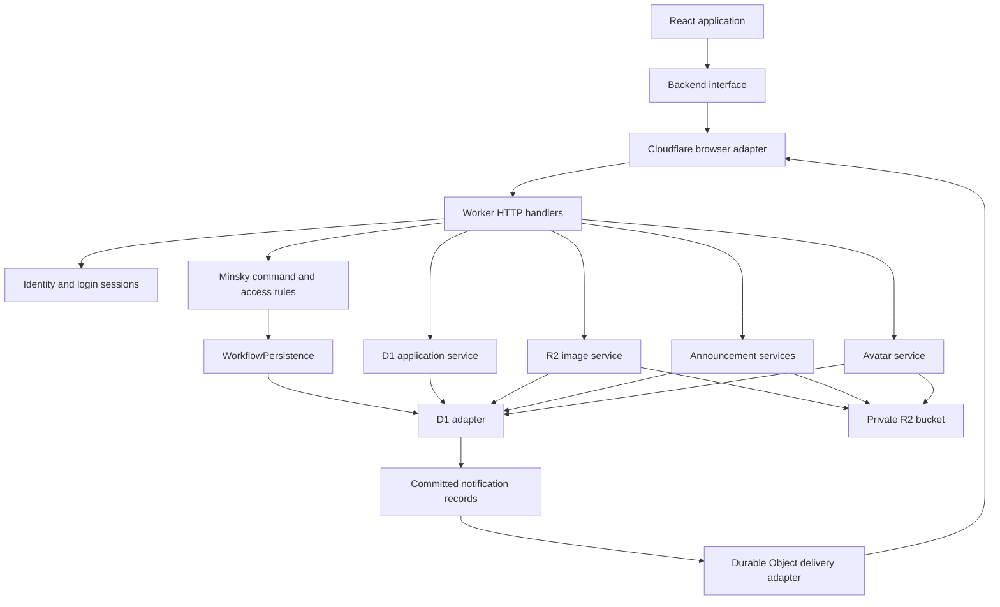

# Cloudflare backend design

This page explains the Cloudflare connector and its provider boundaries.
The browser uses the `Backend` contract.
Issue decisions use one `WorkflowService`. Provider adapters supply persistence, authentication, images, and live delivery.
Cloudflare is the only backend.

The user selected Workers, D1 with a SQLite rewrite, private R2, and Durable Objects.
On 2026-10-18, the owner selected a fresh development installation instead of transferring existing trial data.
Preserve application behavior and database rules. Create new accounts, IDs, and records through supported installation paths.
Do not transfer accounts, passwords, issues, history, images, or IDs from the earlier backend.
See [activation and recovery](activate-cloudflare-development.md) for the approved development switch and its operating procedure.
See [backend contracts](backend-contracts.md) for the browser interface and [run log](history/run-log.md) for dated evidence.

## Two different adapter boundaries

`Backend` describes what the browser needs from Minsky.
The Cloudflare adapter translates the same operations into authenticated HTTP requests and live subscriptions.

The server needs a separate boundary.
Moving browser calls behind `Backend` does not make a provider's database functions portable.
The [shared workflow service](server-workflow.md) applies the existing issue decisions.
The Cloudflare server reuses those decisions and enforces their commit conditions through its SQLite adapter.
A future AWS, GCP, or Azure server can reuse the same service without importing Cloudflare bindings.
These providers have no implementation. See [Add a backend provider](add-provider.md) for contributor requirements.

The D1 adapter persists all nine commands from that service.
The complete [application Worker](../src/server/adapters/cloudflare/applicationWorker.ts) combines authenticated workflow, reads, administration, images, announcements, and live connections.
It guards current identity sessions and credential generations inside workflow commits.

## Modules have explicit responsibilities

The table defines the boundaries.
The [workflow reference](server-workflow.md) identifies implemented workflow modules and remaining provider-specific paths.
The Cloudflare implementations remain inside provider adapter modules.

| Boundary | Responsibility | Provider details excluded from callers |
| --- | --- | --- |
| Browser `Backend` | Minsky operations and validated results. | SQL, SDK clients, bearer tokens, and subscription channels. |
| HTTP handlers | Validate requests, authenticate callers, and map typed results to responses. | Business rules inside route handlers. |
| Domain rules | Decide valid transitions and required changes from explicit account and workflow state. | Worker bindings, environment variables, SQL syntax, and network calls. |
| `WorkflowPersistence` | Read authorized workflow state and commit a decision with its preconditions, receipt, history, and notifications. | Generic table CRUD and caller-controlled transactions. |
| Identity service | Verify credentials and login sessions, change passwords, and revoke access. | Provider token formats and password storage details. |
| Blob store | Store immutable image objects, inspect content, read bytes, and retry deletion. | Bucket clients and provider URLs. |
| Change delivery | Deliver authorized snapshot invalidations and recover pending notifications. | Durable Object classes and WebSocket lifecycle details. |

The application Worker constructs [D1 application access](../src/server/adapters/cloudflare/application.ts), [R2 images](../src/server/adapters/cloudflare/images.ts), [D1 announcements](../src/server/adapters/cloudflare/announcements.ts), [R2 announcement images](../src/server/adapters/cloudflare/announcementImages.ts), [R2 account avatars](../src/server/adapters/cloudflare/avatars.ts), and [live delivery](../src/server/adapters/cloudflare/live.ts).
See [session announcements](session-announcements.md) for the announcement rules.
Removal keeps the announcement row, its image rows, and their R2 objects for a future contest log export.
The [browser adapter](../src/backend/cloudflare/backend.ts) implements every `Backend` group.
Issue decisions remain shared. Other operations preserve their behavior in the corresponding provider server adapter.
The [operator tooling](../src/server/adapters/cloudflare/tooling/install.mjs) owns Cloudflare configuration, target checks, bootstrap, and owner recovery.

`WorkflowPersistence` defines complete workflow operations.
Each persistence adapter owns the transaction needed by an operation.

Workflow decisions use explicit authorized state.
The persistence adapter supplies authoritative timestamps and generated IDs during commit.
The provider store verifies that the state remains current when it commits the decision.
Typed commit results distinguish a conflict, a confirmed rejection, and an unknown outcome.
Database constraints still protect relationships and uniqueness.

One deployment entry point constructs the provider implementations from explicit configuration.
Each authenticated request gets its own caller context.
There is no mutable global current provider or current user.
Provider imports stay in adapter modules. Domain code has no `if (provider === ...)` branches.
Simple constructors and function arguments are sufficient. A general dependency framework is unnecessary.

The Cloudflare HTTP response distinguishes a validated command result from an explicit, typed rejection.
The browser maps only a confirmed rejection to `WorkflowRejectedError`.
Timeouts, unexpected statuses, and malformed responses preserve the unknown outcome and request ID.
The response contains no raw SQL, provider error objects, or identity credentials.
An HTTP status alone does not prove that a command failed before commit.

Provider compatibility means implementing these semantics and passing the same tests.
It does not mean every provider has the same transaction or storage API.
Terraform can later provision selected resources. Terraform does not replace application adapters or behavior tests.

## D1 stores the authoritative application state

The connector uses one application database per environment.
The complete schema includes workflow, account, administration, image, announcement, avatar, and notification records.
The same database contains account access state and all memberships.
This permits password-reset authorization across every session assigned to an account.
Splitting databases by contest session would require a separate consistency design for that rule.

The SQLite schema uses UUIDs as stable identifiers within its own installation.
Submission allocates a number above the current session's existing issue numbers inside its commit.
Foreign keys retain session boundaries between teams, issues, resolutions, awards, and images.
Unique constraints retain one award per issue and one current resolution per issue.
Roles use explicit membership-role records and retain combined staff capabilities.

New D1 commits obtain ISO 8601 timestamps from the database.
Fresh installation starts without imported records or timestamps.
There is no verified data import procedure.
Saved resolution intervals remain the basis of elapsed-time calculations.

The browser accesses D1 through the authenticated Worker API.
Trusted operator commands and isolated fixtures use provider bindings separately.
Every read includes the authenticated account and its current access conditions.
The store assembles snapshots in one consistent database operation.
It excludes other teams' records and staff-only records before they leave the server.
Account status, login revocation, and mandatory password changes also guard file reads and live connections.

One resolver in [authority.ts](../src/server/adapters/cloudflare/authority.ts) decides what an account may do in a contest.
Every reader and writer of contest data embeds it: snapshots, workflow commands, images, announcements, avatars, live connections, the contest list, contest settings, and account changes.
The resolver merges three sources:

- A membership and its roles in the contest.
- An event grant for the contest's event. The holder is an event admin.
- A site grant. The holder is a webmaster.

Event admins and webmasters resolve to an admin seat in every contest that they reach, so the rules for contest admins apply to them unchanged.
An account belongs to one event. D1 refuses a membership or an event grant that crosses events.
While the site setting `restrict_webmaster_reads` is on, a webmaster reads a contest's data only after an audited join. Contest settings and account changes ignore that setting.
Each answer carries a stamp of every version that it depends on. A write batch evaluates the resolver again and compares the stamp.
[capabilities.ts](../src/connected/capabilities.ts) holds the one table of what a seat may do. Workflow decisions and the browser's page gates both read it.
Migration `0017` promotes the accounts named `organizer` and `playtest-admin` to webmasters when each is a contest admin with no team seat. They keep their admin memberships. Bootstrap gives its one account a site grant.

[manage.ts](../src/server/adapters/cloudflare/manage.ts) serves site administration to webmasters:

- `GET /api/site` returns the webmasters, the read restriction, and the contests that the caller has not joined. It returns `null` for an account that is not a webmaster.
- `POST /api/manage` runs one command: `add_webmaster`, `remove_webmaster`, `set_webmaster_reads`, or `join_contest`. A table keyed by command type gives each command's requirement. One batch checks the caller's stamp before its writes, and stores the receipt and a site audit row with them. A retry with the same request ID returns the first receipt.
- `POST /api/credentials` issues a temporary password for up to eight other webmasters. The hashes run first, then one batch replaces every password. A retry with the same request ID returns the accounts without passwords.

D1 keeps the last enabled webmaster, refuses a join while webmasters read every contest, and writes both audit rows of a join.
The [event platform design](event-platform-design.md) describes the later phases.

The implementation uses primary database reads for authorization and snapshots.
Cloudflare routes binding queries to the primary unless the application uses the Sessions API for replication.
Replica reads require a tested consistency rule for revocation and reads after writes before adoption.
See [D1 read replication](https://developers.cloudflare.com/d1/best-practices/read-replication/).

## One workflow command has one database commit

A workflow command commits state, history, signals, and the request receipt together.
D1 `batch()` accepts prepared statements and rolls back the batch if a statement fails.
It does not provide a JavaScript transaction callback around arbitrary asynchronous work.
See [the D1 database API](https://developers.cloudflare.com/d1/worker-api/d1-database/).

The store first reads the state needed to evaluate a command.
Domain rules produce either a rejection or a complete change with expected versions.
The store submits one bounded batch with these elements:

1. An assertion checks current access and the captured account, membership, event, session, and workflow dependencies.
2. The batch obtains one database timestamp and writes the issue, resolution, reopening, or award effects.
3. The batch records history, the unique actor/request receipt, and audience-specific notifications.
4. A final access assertion rejects expiry or revocation before the batch completes.

The assertions execute inside the batch.
A failed assertion must raise a database error and roll back every write.
A conditional update that affects zero rows must not allow the remaining writes to commit.

Every changed dependency increments its internal version in the same commit.
Membership changes also increment the affected account's access version.
Account-wide administration checks include the target account's complete membership set.
This prevents a concurrent membership grant from escaping a password-reset permission check.

The public issue revision remains the value used by `Command` in [model.ts](../src/connected/model.ts).
A separate internal write version detects concurrent changes that must not become public.
Private notes cannot increment the contestant-visible revision or send contestant notifications.
An internal conflict causes a bounded reread and reevaluation inside the server.
It must not reveal a private note through a public conflict message.

A stored receipt includes the session ID, canonical command, and result ID.
Canonical means that equivalent JSON object key order produces the same comparison.
Reusing the request ID with different content is a confirmed rejection.
A concurrent duplicate either commits once or reads the existing receipt after current access checks.
Transport loss and an unreadable success response leave the outcome unknown.
The adapter retains the original request ID, as the current UI requires.

There is no transaction across D1, R2, and Durable Objects.
The D1 commit records later work before any external side effect begins.
A retry repeats that work safely without repeating the workflow command.
Administration methods currently lack workflow-style request IDs.
The browser does not automatically retry those administration calls with a workflow-style guarantee.
An uncertain credential result requires checking account state or issuing a later authorized reset.

## Authentication uses organizer-issued temporary passwords

The owner selected a new administrator through the supported bootstrap process on 2026-10-18.
This decision replaces the earlier account-preservation requirement.
The new installation creates its own identities and memberships.
Users must change organizer-issued temporary passwords before contest access.
No account, password, password hash, or account ID transfers from the earlier backend.

The Cloudflare identity adapter uses maintained Better Auth.
See [the implementation reference](cloudflare-authentication.md) and [choice with costs](cloudflare-authentication-choice.md).
The Cloudflare application uses this identity boundary.
Minsky retains its username rules, organizer recovery, mandatory password changes, and cross-session authorization.

The connector verifies current login state for each protected operation.
A signed token alone does not prove that the login remains active.
Issued tokens can outlive session deletion at some identity providers.

The Worker API uses a secure, HttpOnly session cookie and an opaque login identifier for same-origin application requests.
The identity adapter owns expiry, rotation, and revocation. The browser receives no database credentials.
State-changing routes check the request origin and a cross-site request forgery token.
The WebSocket upgrade checks the origin and current login too.
Preview origins and cross-origin local development need an explicit allowlist and browser tests.
The application uses host-only HttpOnly cookies, SameSite Strict, and a fixed eight-hour lifetime.
Hosted cookies require Secure. The authentication reference defines exact origins and request protection.

Password resets first place the account behind the mandatory-change gate and revoke earlier logins.
The authorization check, gate, account access version, and audit record commit together.
Only an administrator of every assigned session can reset the account or assign its initial username.
An archived event in any assigned session prevents these account changes.
The current behavior rejects replacement of an assigned username and directs self-resets to `changePassword()`.
A credential update uses a persisted operation record with a guarded completion state.
Failure leaves the account restricted instead of restoring an earlier valid login.

## Private R2 images use explicit lifecycle states

The browser keeps the existing `ImageTransport` operations and logical image paths.
The Worker authenticates every upload, completion, download, removal, and abandonment.
The R2 bucket has no public route.
The implementation proxies downloads through the Worker with private, non-cacheable responses.
This avoids a reusable public link after membership revocation.

`begin()` atomically reserves an attachment, its immutable visibility, declared bytes, quota allowance, and request receipt in D1.
Only staff can reserve an image in an active event.
Reservations count toward limits so concurrent uploads cannot exceed the limit.

An upload writes immutable object bytes under the reserved original or thumbnail key.
Conditional object creation prevents two attempts from replacing each other's validated bytes.
An existing object requires content verification before a retry counts as success.
R2 supports conditional writes through its Worker binding.
See [R2 conditional operations](https://developers.cloudflare.com/r2/api/workers/workers-api-reference/).

`finish()` verifies both objects, actual sizes, and supported image headers.
The checks retain [imageFile.ts](../src/connected/imageFile.ts) behavior for JPEG, PNG, WebP, and thumbnails.
The final D1 commit rechecks the login, uploader, membership, event state, quota, and reservation.
Only that commit changes the attachment to ready and records visible activity.
Repeating `finish()` after success returns success without another activity record.

Removal first commits a tombstone, which marks the image unavailable, with the authorized uploader and a durable deletion task.
Only the uploader can remove a ready image while its event is active.
R2 deletion and completion of the task happen afterward.
File access rejects a tombstone immediately, even if object deletion needs another attempt.

Expired or abandoned uploads also create deletion tasks for their exact keys.
An upload that finishes after revocation or expiry cannot publish its object.
The worker rechecks reservation state after upload. A recovery scan removes orphaned bytes after interrupted requests.
Recovery retains tombstones and repeats exact-key deletion to catch late transfers.

R2 object consistency does not make a D1 metadata change and an R2 write atomic.
Cache behavior can also differ from direct bucket reads.
See [R2 consistency](https://developers.cloudflare.com/r2/reference/consistency/).

## Account avatars use the private image bucket

Profile pictures belong to accounts. [Migration 0011](../src/server/adapters/d1/migrations/0011_account_avatars.sql) adds `account_avatars`.
[R2AvatarService](../src/server/adapters/cloudflare/avatars.ts) stores each file in the existing private bucket under `accounts/<accountId>/avatars/<avatarId>`.
Issue and announcement image keys start with a session ID. Avatar keys start with `accounts/`.
No new bucket, binding, or secret is needed.

A row is `pending`, `ready`, `retired`, or `expired`.
The ready row is the account's current picture. A partial unique index allows one ready row for each account.
Triggers keep the owner, request ID, size, type, and digest unchanged. They allow only `pending` to `ready` or `expired`, and `ready` to `retired`.

`PUT /api/avatar/<requestId>` stores a picture in this order:

1. The Worker reads at most 256 KiB. It checks the JPEG, PNG, or WebP signature and the `X-Minsky-Digest` SHA-256 value.
2. A D1 batch inserts a `pending` row and checks the login.
3. A conditional R2 write stores the bytes. R2 checks the digest.
4. One D1 batch checks that the row is pending and not expired. It retires the earlier ready row, makes the new row ready, and checks the login again.
5. The Worker deletes the file of the retired row.

A failure before step 4 leaves a pending row that nobody can read. A retry with the same request ID can finish it.
A failure after step 4 leaves a retired row whose file deletion is still due.
`POST /api/avatars` with `{ "action": "remove" }` retires the ready row and deletes its file. It succeeds when no picture exists.
Both routes use the existing origin, cookie, and request-protection checks.

`GET /api/avatars?sessionId=<id>` lists the pictures that the caller can read in that session.
The list starts from the caller's own picture and, for staff, from the staff memberships of that session. It reads no picture of another session.
`GET /api/avatar/<sessionId>/<avatarId>` checks the visibility rule, reads R2, and checks the rule again before it returns the bytes.
The response is private and not cacheable.

The minutely maintenance run expires pending rows after 15 minutes.
It repeats the exact file deletion of retired and expired rows, as it does for other images, so it also removes a late transfer.

The foreign key from `account_avatars` to `accounts` has no cascade.
Deleting an account fails while it has avatar rows.
Fixture cleanup therefore deletes the exact avatar keys, then the rows, then the accounts. A cleanup that forgets the files fails instead of leaving them in R2.

## Durable Objects deliver invalidations

D1 stores a pending notification with each committed change.
This table is an outbox, a durable record of notifications still needing delivery.
It contains the session, permitted audience, sequence, and delivery status.
It contains no issue text, image key, password, or private note body.

The connection coordinator is one Durable Object per contest session.
The Worker attempts delivery after the database commit.
A scheduled recovery scan retries pending rows if the Worker stops before delivery.
The coordinator accepts repeated deliveries and ignores older duplicate sequences for the same audience.

A dispatcher claims up to 500 pending rows with one `UPDATE … RETURNING` statement.
The claim sets `claimed_until` to 30 seconds later, so a concurrent dispatcher does not take the same rows.
The dispatcher sends one request to each session's coordinator.
The request holds only the highest claimed sequence for each audience, so a burst of changes to one audience sends one hint.
The dispatcher marks the rows delivered after the coordinator accepts the request.
It repeats this until no rows remain or 10 seconds have passed.
A failed or uncertain delivery keeps its claim until the claim expires. The next dispatcher then retries it. This delay prevents every new request from sending the same failing rows again.
The index `notifications_claim_order` serves the claim order without a sort.

An account without a login has no live connection.
Account setup therefore writes only the `staff` notification for that account. A later first connection starts with a full refresh.

Acknowledging delivery means that the coordinator accepted the invalidation. It does not prove that every browser received it.

Team changes reach the affected team and staff.
Staff-only changes reach staff only.
Private changes use separate sequences, so contestant notifications and counters cannot reveal their existence.
Membership changes and password resets produce targeted access invalidations.
The coordinator rechecks current authorization before each delivery, including duplicate hints, and closes invalid logins.
It reads the grants for all of its sockets before it sends a hint. It uses one D1 query for each group of up to 500 logins.
An unavailable authorization service causes delivery to stop rather than reuse stale permissions. No socket receives that hint.

The coordinator stores each socket's account ID, login ID, session ID, and expiry.
Those values identify a connection. They do not replace current permission checks.
Connection metadata survives hibernation through socket attachments.
See [Durable Objects WebSocket hibernation](https://developers.cloudflare.com/durable-objects/best-practices/websockets/).

An alarm checks current access and closes expired or revoked connections.
Access invalidations request earlier checks.
The handler reschedules checks for its remaining sockets.
Cloudflare retries failed alarms a bounded number of times.
See [Durable Objects alarms](https://developers.cloudflare.com/durable-objects/api/alarms/).

Every successful connection or reconnect triggers a fresh authorized snapshot.
A missed invalidation cannot require the browser to reconstruct issue history from messages.
While the live channel is connected, the browser refreshes on live hints, on focus, when the tab becomes visible, and once every 60 seconds.
The 60-second refresh is a safety net. It bounds the delay for changes that send no hint: a profile picture change, an announcement expiry, and a password reset.
While the channel is down or reconnecting, the browser refreshes every 10 seconds as before.
A drop or a reconnect starts a refresh at once.
One timer in `useSessionSnapshot` drives the snapshot, announcement and picture reads.
The account check in `useAccountStatus` uses the same schedule.
`createCloudflareAuthentication` keeps its own 60-second session check.
Closing a subscription stops callbacks immediately and releases the socket and timers.

The healthy-connection target remains live updates within three seconds.
Immediate delivery is the normal path. Recovery scans and polling handle missed messages but do not establish that latency target.

## The Worker sets the security headers

The Worker runs before static assets. Cloudflare does not apply a `_headers` file to responses from Worker code, so a `_headers` file would not work here. See [Workers static assets headers](https://developers.cloudflare.com/workers/static-assets/headers/).
[securityHeaders.ts](../src/server/adapters/cloudflare/securityHeaders.ts) sets the headers on every asset response and on every API response.

| Header | Applies to | Value |
| --- | --- | --- |
| `Content-Security-Policy` | HTML documents | Scripts, fonts, connections, and forms use only the same origin. No eval. No object, frame, or foreign base. `frame-ancestors 'none'`. |
| `Content-Security-Policy` | API responses | `default-src 'none'; frame-ancestors 'none'` |
| `Strict-Transport-Security` | Every response | `max-age=31536000` |
| `X-Content-Type-Options` | Every response | `nosniff` |
| `Referrer-Policy` | Every response | `no-referrer` |
| `X-Frame-Options`, `Permissions-Policy` | HTML documents | `DENY`; camera, microphone, location, and payment off |
| `Cache-Control` | Built files named `/assets/<name>-<hash>.<extension>` | `public, max-age=31536000, immutable` |

The policy allows two things that a stricter policy would block:

- `style-src 'unsafe-inline'`. Sonner, the Radix scroll lock, and the image cropper add `<style>` elements at run time. Script stays strict, so this does not allow script injection.
- `font-src data:`. The build inlines one small font file as a `data:` URI.

The browser app turns off Zod's code generation (`src/lib/zodConfig.ts`, the first import of `src/main.tsx`). Zod would otherwise call `new Function` once to test for eval. The policy blocks that call and the browser reports a violation.
The local browser journey (`npm run test:connector:ui:local`) fails if any page reports a policy violation.

Vite puts a content hash in the name of every built file under `/assets/`, so a new build never reuses a URL. The Worker caches those files for a year.
Every other asset keeps the `Cache-Control` value that Cloudflare sends, `public, max-age=0, must-revalidate`.
This includes `/` and `/favicon.svg`.
The single-page fallback answers a missing `/assets/` name with the HTML shell and status 200, so the Worker does not cache an HTML response or an error response for a year.

## Separate installation and activation

The documentation Worker remains a static site with no application data bindings.
The application Worker serves static assets and backend requests under one origin.
The generated configuration runs the Worker before static asset handling, so private-path checks also apply to application routes.
Development, CI, and future production use separate databases, buckets, object namespaces, and identity credentials.
Untrusted branch previews receive no shared database write access or privileged credentials.

The installation procedure requires an empty isolated database and explicit provider targets.
Use [Install an isolated Cloudflare instance](../site/src/content/docs/operators/installation.mdx) for configuration, bootstrap, and recovery.
The [PR #21 component record](history/pr21-installation-disposition.md) preserves reuse decisions and the recommendation to close PR #21. The owner's closure decision remains pending.

Data exports and migration tooling are outside the fresh-installation scope.
The owner approved the concrete development switch separately from the PR #43 merge.
On 2026-10-23 the owner selected Cloudflare as the live backend. The development Worker is `minsky-dev` and its D1 database is `minsky-development`.
Future backend switches still require separate approval.
Use the [activation procedure](activate-cloudflare-development.md) for exact targets, the reviewed revision, deployment commands, verification, and recovery.
The separate documentation Worker retains its independent deployment.
Each installation must establish its own capacity and latency evidence before live-contest use.
